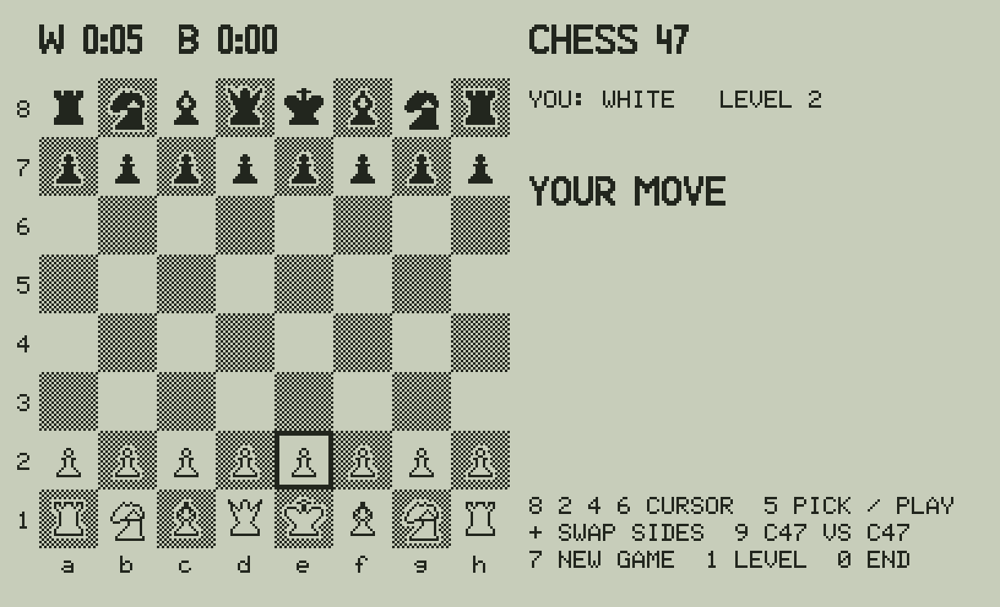
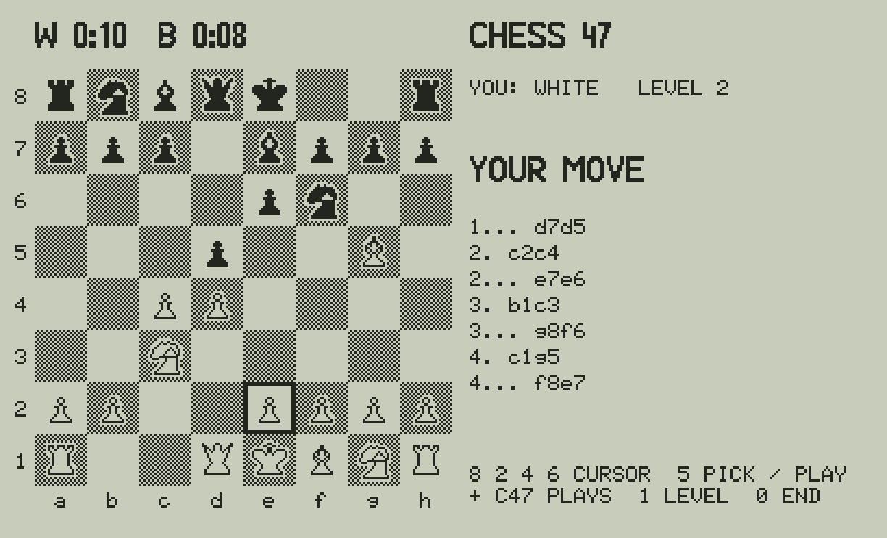
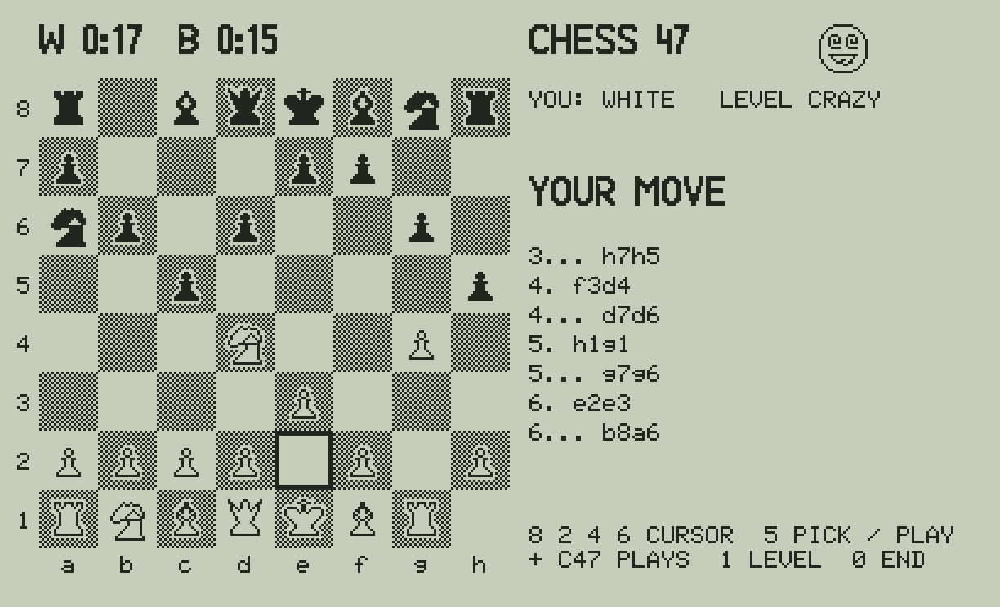

# Chess 47 ♟️

A chess engine for the **C47 / R47** RPN calculator (and the DM42n with the C47 firmware): you play against the
calculator on its own screen. As far as I know, the first chess engine for the C47.

The engine follows the idea of the "matrix" mini engines (Micro-Max, H.G. Muller). The board is a matrix, the
10 × 12 mailbox, and the engine works from it: the move generator, check and mate, and a 2-ply alpha-beta search
with a score kept up to date by every move. v0.2 adds mate detection, the recapture after a capture and the
biggest captures first (it beat v0.1 18.5 to 1.5 in 20 games), an opening book, a chess clock, draws by
repetition and by material, and a CRAZY level of random moves.

| | |
|---|---|
| File | `build/CHESS47.txt` (convert with rejig), commented: `build/forum/CHESS47.p47u`, source: `programs_rem/CHESS47.txt` |
| Needs | C47 / R47 firmware with STRUCT, ATEXT, GRFNT, AGRAPH and the bitwise commands (00.109.05.00a0.ALPHA, 5 Oct 2026, or later) |
| Size | 4 632 steps, about 14 KB (.p47, estimated); while it runs the matrices BD, PT, ML, UN, GL, GH, OB (about 3 600 numbers) |
| At the end (0) | your stack and LASTx as before; R00-R19 untouched, R20-R99 cleared; the matrices and the clock's variables TK TW TB deleted; WSIZE 64, GRMOD 0, GRFNT 20 |

## Playing

`XEQ "CHESS47"`. Setting up takes about 10 s (the tables and the board). You have the white pieces.

| Key | |
|---|---|
| **8 2 4 6** | the cursor up, down, left, right |
| **5** | pick a piece of yours (its square is inverted), then **5** on the square to play it; 5 on the same square drops it |
| **+** | the C47 plays the side to move (you take the other side): press it at the start to play black, or to watch |
| **1** | the level: 2 (2 plies, about 20-55 s a move), 1 (1 ply, a few seconds), 0 **CRAZY** (random legal moves at once, a crazy face by the title) |
| **0** | the end |

The rules are all there: castling (not out of, through or into check), en passant and promotion (always to a queen).
CHECK, CHECKMATE, STALEMATE, DRAW: REPETITION (the same position the third time, the same side to move) and DRAW: MATERIAL
(kings only, or one bishop or knight) are shown; there is no 50-move rule. An illegal move is refused (ILLEGAL MOVE, or
ILLEGAL: CHECK when it leaves your king attacked). The last seven moves are listed on the right. The clock at the top
left counts each side's time (TICKS, the time of the side to move; it stops when the game is over).

The C47 opens from its book (python/book.py: 14 main lines, Ruy Lopez to Réti, 10 plies each) as long as the game
follows one of them, choosing at random among those that fit; then it thinks.

**Strength:** v0.1 by my estimate about 800-1100 Elo; v0.2 beat v0.1 18.5-1.5 in 20 games (the Python twins), so
perhaps 1100-1300. Not measured against rated players. It sees mates in one, one-move tactics and the recapture; it
misses deeper tactics. The matches against an independent player in the simulator: `docs/MATCHES.md`.

## How it works

- **The board:** a 1 × 120 matrix BD, the 10 × 12 mailbox (a1 = 22 … h8 = 99, the border 8). A piece is 1-6
  (pawn, knight, bishop, rook, queen, king), positive for white and negative for black. A move is from × 1000 + to.
- **The score:** a matrix PT (13 × 99) holds the signed value of each piece on each square (material + a piece-square
  table). Each move updates SC from three or four lookups, and SC is never recomputed.
- **The moves of a ply** go into a row of the matrix ML, and the undo data into a row of UN.
- **The search:** 2 plies with alpha-beta cuts. The moves come out of the generator ordered: the captures by the
  value taken, queen first (an insertion as they are added), then the others. A move that lets the king be taken
  scores about -20000, so the search never chooses one. A checking move after which the other side has no legal
  move is a mate (29000). A capture reply is played and answered by its recapture when the square is attacked;
  the other replies are not played: their effect on SC is worked out directly.
- **The 64-bit bitwise commands:**
  - the castling rights are one 4-bit word (`AND` clears a right, `BS?` tests one);
  - the dark squares are computed from the glyphs: dither `AND NOT` mask `OR` glyph (WSIZE 24, a 24-pixel column is one
    `AGRAPH` word), so only one set of glyphs is stored;
  - each position after a move gets a 32-bit key, Zobrist style: one word for each piece on its square, `XOR`ed together
    (WSIZE 32); the keys of the game (the matrix GH, with `→REAL`) find the threefold repetition.
- **The matrices:** the board BD, the values PT, the move lists ML, the undo UN, the glyphs GL, the game record GH
  (moves and keys), the opening book OB.
- **Not used:** EIGEN and the 34-digit precision don't make a chess engine stronger, so they are not forced in.
  The plans for more strength are in `DEVELOPMENT_NOTES.md`: bitboards, a capture search, mate detection, an opening book.

## Tested

In the C47 simulator only (`python/c47sim.py`, from Almanac 47), with `python3 tests/test_chess47.py`. The test checks
against `python/chess47ref.py`, the same engine in Python:

- the move generator gives the same moves, in the same order, for 12 positions: castling, en passant, promotion, pins;
- the reference generator gives the published perft counts (20 / 400 / 8 902 / 197 281 from the start, Kiwipete,
  position 3), with promotions to a queen only;
- the search gives the same move and value at levels 1 and 2 (mates in one found);
- a game of the C47 against itself: the book moves are from its lines, then move for move the same, with the same
  board and score; 20 CRAZY moves all legal; the clock runs;
- 10 matches against an independent python-chess player (`tools/match47.py`): every move legal, the board right
  after every move, every game ended as the rules say;
- moves keyed with 5 and the arrows work, and illegal moves are refused;
- the start screen matches `python/layout.py`'s picture pixel for pixel.

**Not yet run on a real C47.** `AND`, `OR`, `NOT`, `XOR` and `BS?` are new to these projects (Logic 47 uses them too and
is also still to be run on the calculator), and `→REAL` is new here: please try them first.

## Files

| | |
|---|---|
| `programs_rem/CHESS47.txt` | the commented source (STRUCT, named labels) |
| `tools/build_chess47.py` | writes `programs/`, `build/` and `listings/`, and `build/forum/CHESS47.p47u` |
| `python/layout.py` | the board's place, the piece glyphs, the crazy face (the build writes their words into the program) |
| `python/book.py` | the opening book (the build writes it into the matrix OB) |
| `tools/match47.py` | matches in the simulator against a python-chess player, written to `docs/MATCHES.md` |
| `python/chess47ref.py` | the engine in Python, step for step as the program, and perft |
| `python/chess47sim.py` | runs the program in the simulator and writes the screens in `docs/` |
| `python/c47sim.py`, `stdfont.py`, `tinyfont.py` | the C47 simulator and fonts, from Almanac 47; the bitwise commands from Logic 47 |
| `tests/test_chess47.py` | the tests above |

## Author

By Victor Valdes (valdes.vj@gmail.com),

Thank you to the C43/C47 firmware developers and SwissMicros. Written with the help of AI. See `AI_ASSISTANCE.md` for
the responsible-use statement.

## License

Published under the [GNU General Public License v3.0](LICENSE). Free to use, modify, and share for the calculator
community.
