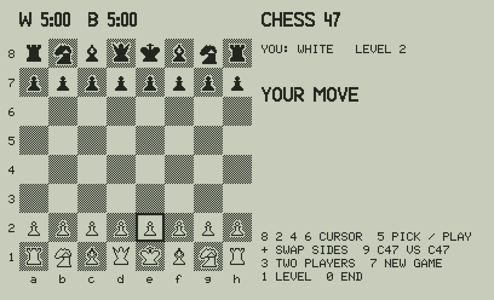
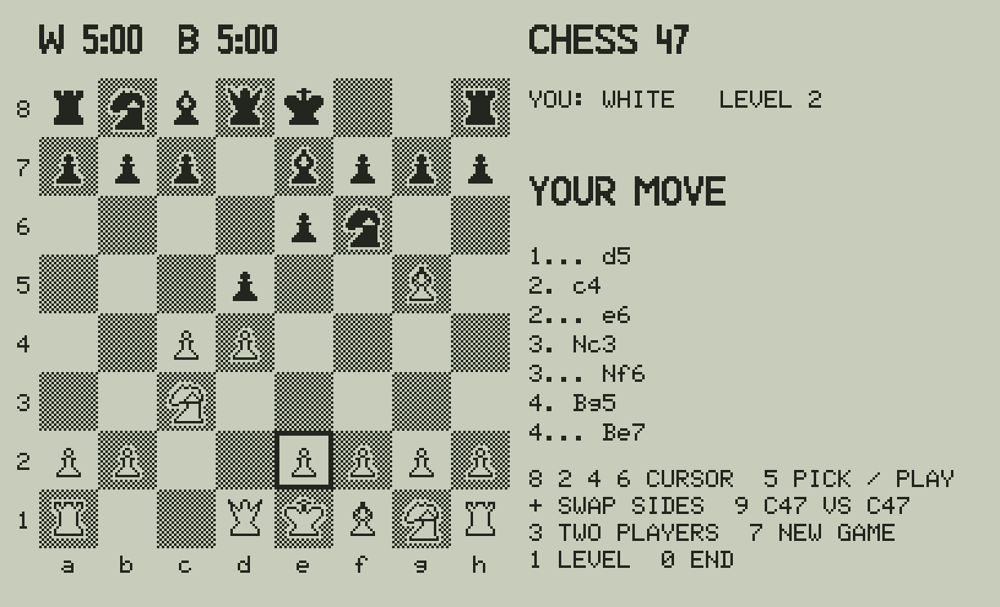
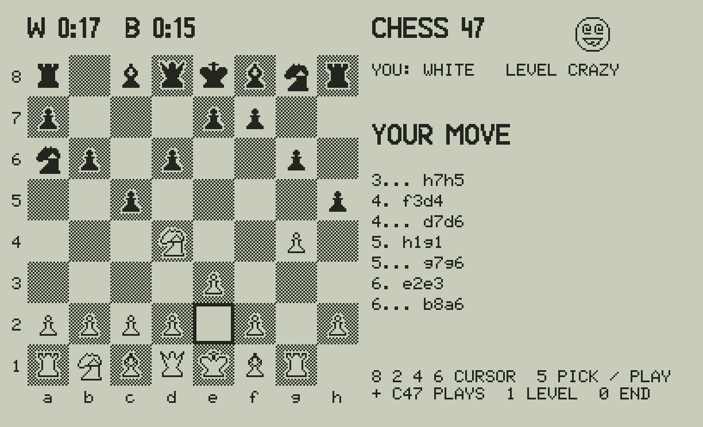
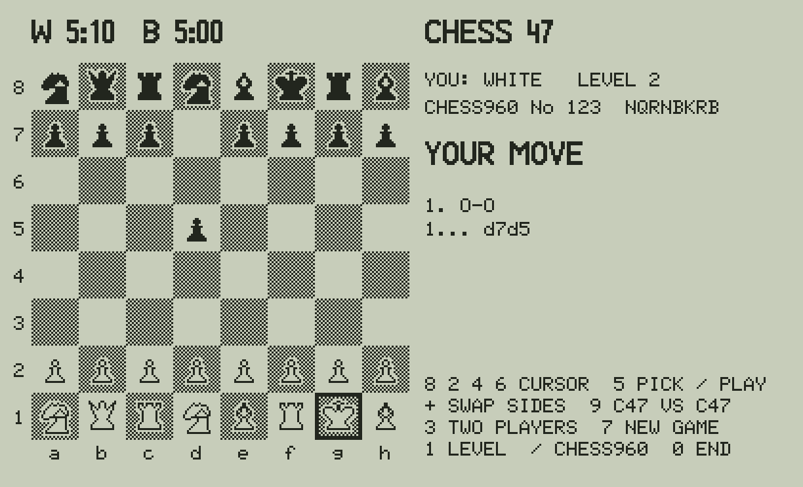

# Chess 47 ♟️

A chess engine for the **C47 / R47** RPN calculator (and the DM42n with the C47 firmware): you play against the
calculator on its own screen. As far as I know, the first chess engine for the C47.

The engine follows the idea of the "matrix" mini engines (Micro-Max, H.G. Muller). The board is a matrix, the
10 × 12 mailbox, and the engine works from it: the move generator, check and mate, and a 2-ply alpha-beta search
with a score kept up to date by every move. v0.2 adds mate detection, the recapture after a capture and the
biggest captures first (it beat v0.1 18.5 to 1.5 in 20 games), an opening book, a chess clock, draws by
repetition and by material, and a CRAZY level of random moves. v0.3 plays the same moves about 3 times faster (a
move at level 2 about 13-19 s instead of 46-55 s, in the simulator's step count), v0.3.4 (the killer move) about 7-12 s:
see *Speed* below. v0.4.0 adds Chess960.

| | |
|---|---|
| File | `build/CHESS47.txt` (convert with rejig), commented: `build/forum/CHESS47.p47u`, source: `programs_rem/CHESS47.txt` |
| Needs | C47 / R47 firmware with STRUCT, ATEXT, GRFNT, AGRAPH and the bitwise commands (00.109.05.00a0.ALPHA, 5 Oct 2026, or later) |
| Size | 6 969 steps, about 21 KB (.p47, estimated); while it runs the matrices BD, GL, GH, OB (about 4 300 numbers) and the variables NW NB |
| At the end (0) | your stack and LASTx as before; R00-R19 untouched, R20-R99 cleared; the game kept for the next start (the variables CHN, GH, TW, TB); the other matrices, TK and the knight words NW NB deleted; WSIZE 64, your integer mode back, GRMOD 0, GRFNT 20 |

**The manual, with pictures: [docs/MANUAL.md](docs/MANUAL.md).**

## Playing

`XEQ "CHESS47"`. Setting up takes about 10 s (the tables and the board). You have the white pieces; a game left with
**0** goes on where it was (the moves played again: a few seconds more).

| Key | |
|---|---|
| **8 2 4 6** | the cursor up, down, left, right |
| **5** | pick a piece of yours (shown white on black, on light and dark squares), then **5** on the square to play it; 5 on the same square drops it |
| **+** | swap sides: the C47 plays the side to move and you take the other; at the start: you play black (the board turns, black at the bottom) |
| **9** | C47 vs C47: it plays both sides until checkmate or a draw; any key stops it and you take the side to move (0 ends) |
| **3** | two players: two people play on the calculator; the C47 only checks the moves and calls check, mate and the draws (+ or 9 give it a side again) |
| **7** | a new game of normal chess (the level and your side kept) |
| **÷** | a new **Chess960** game (Fischer random chess): type its number with three digits (066 for 66; 518 is normal chess's start), or ÷ again for a random one; another key goes back. The number is shown under your side. Castling: pick the king, then its own rook (the king goes to g or c, the rook to f or d, as FIDE's Chess960 rules); the opening book is not used. 0 keeps the game with its number |
| **1** | the level, in turn: 2 (2 plies, about 6-11 s a move), 1 (1 ply, a few seconds), 0 **CRAZY** (random legal moves at once, a crazy face by the title), **3** (level 2 first, then 3 plies for at most 60 s more: the deeper move when it is found in time, else the best found so far or level 2's) |
| **0** | the end; the game is kept and goes on at the next start (not when it is over) |

The rules are all there: castling (not out of, through or into check), en passant and promotion (always to a queen).
CHECK, CHECKMATE, STALEMATE, DRAW: REPETITION (the same position the third time, the same side to move) and DRAW: MATERIAL
(kings only, or one bishop or knight) are shown; there is no 50-move rule. An illegal move is refused (ILLEGAL MOVE, or
ILLEGAL: CHECK when it leaves your king attacked). The last seven moves are listed on the right in standard algebraic notation, as in a book or a
scoresheet: e4, Nf3, exd5, Nbd2, R1e2, O-O, e8=Q, Qh7+, Ra8#. The clock at the top
left shows each side's time left: **5 minutes each, 10 seconds more for every move played** (a Fischer clock, so a
lively game can go on as long as it flows). **Only a person's clock runs**: the C47's stops while it thinks (at
level 2 it needs more than the 10 s a move), so it never loses on time, and C47 vs C47 always plays to the end. The side whose time runs out loses (WHITE / BLACK LOST ON TIME), unless the opponent cannot mate by any
series of legal moves (FIDE 6.9: a bare king, a lone knight against only king and queens, bishops all on one colour
with no pawn or knight): then DRAW: TIME, NO MATE. Setting
up is nobody's time; the clock stops when the game is over and is kept with a saved game.

The C47 opens from its book (python/book.py: 14 main lines, Ruy Lopez to Réti, 10 plies each) as long as the game
follows one of them, choosing at random among those that fit; then it thinks.

**Strength:** v0.1 by my estimate about 800-1100 Elo; v0.2 beat v0.1 18.5-1.5 in 20 games (the Python twins), so
perhaps 1100-1300. Measured (`tools/elo47.py --ladder`, `docs/ELO.md`): level 2 about **1110** (95 %: 1000-1220), level 1
about 890, on Stockfish's UCI_Elo scale (engine blitz, not FIDE), from 168 games against Stockfish 1320, weakened
Stockfish and a material player. It sees mates in one, one-move tactics and the recapture; it
misses deeper tactics. The matches against an independent player in the simulator: `docs/MATCHES.md`.

## On the computer, with Chess960 (`tools/play47.py`)

A trial version for the computer: the C47's screen (the same glyphs, fonts, places and LCD colours), the same engine
(`python/chess47ref.py`), the same keys and rules, and Chess960 (Fischer random chess, in CHESS47 too since v0.4.0).

    pip install pygame
    python3 tools/play47.py          (--new for a new game; else the last one goes on, kept in ~/.chess47_play.json)

`/` starts a Chess960 game: type its number 0-959 and Enter (Enter alone: a random one; 518 is normal chess). Castling
in Chess960: pick the king, then its own rook (the king goes to g or c, the rook to f or d). The book is for normal
chess only. The engine's Chess960 (`python/chess960.py`, a subclass of the twin, which is not changed) is checked
against python-chess by `tests/test_960.py`: the 960 start positions, perft, and the legal moves at every ply of 300
random games (castling included).

## How it works

- **One matrix BD (22 × 120)** holds everything the search reads, so it never switches INDEX:
  - row 1, the board: the 10 × 12 mailbox (a1 = 22 … h8 = 99, the border 8). A piece is 1-6 (pawn, knight, bishop,
    rook, queen, king), positive for white and negative for black. A move is from × 1000 + to;
  - rows 2-4, the move lists (the root, the replies, the moves played);
  - rows 5-17, the score table PT: the signed value of each piece on each square (material + a piece-square table).
    Each move updates SC from three or four lookups, and SC is never recomputed;
  - rows 18-20, the undo data of each ply;
  - rows 21-22, the knight masks and the bit of each square (below).
- **The search:** 2 plies with alpha-beta cuts. The moves come out of the generator ordered: the captures by the
  value taken, queen first (an insertion as they are added), then the others. A move that lets the king be taken
  scores about -20000, so the search never chooses one. A checking move after which the other side has no legal
  move is a mate (29000). A capture reply is played and answered by its recapture when the square is attacked;
  the other replies are not played: their effect on SC is worked out directly. The replies are valued as they are
  generated, starting from the replying side's own back rank, and the generator stops at the first one that refutes.
- **The 64-bit bitwise commands:**
  - the castling rights are one 4-bit word (`AND` clears a right, `BS?` tests one);
  - the dark squares are computed from the glyphs: dither `AND NOT` mask `OR` glyph (WSIZE 24, a 24-pixel column is one
    `AGRAPH` word), so only one set of glyphs is stored;
  - each position after a move gets a 32-bit key, Zobrist style: one word for each piece on its square, `XOR`ed together
    (WSIZE 32); the keys of the game (the matrix GH, with `→REAL`) find the threefold repetition;
  - the knights of each side are a 64-bit word (NW, NB: bit 8 (rank - 1) + file - 1), kept by every move and its
    take-back with `XOR`; "is this square attacked by a knight" is one `AND` with the square's knight mask (row 21 of BD)
    instead of eight probes.
- **The other matrices:** the glyphs GL, the game record GH (moves and keys), the opening book OB.
- **Not used:** EIGEN and the 34-digit precision don't make a chess engine stronger, so they are not forced in.
  The plans are in `DEVELOPMENT_NOTES.md`.

## Speed (v0.5.0)

The same moves and the same values as v0.2 (the Python twin is unchanged), counted in simulator steps over three
middle-game positions at level 2 (0.17 ms a step on the C47):

| | steps | a move |
|---|---|---|
| v0.2 | 872 000 | 46-55 s |
| the replies valued as generated, from their own side, the cut at the first refutation | 296 000 | |
| the capture replies valued without being played; a tighter ray loop for the attack test | 283 000 | |
| one matrix BD for the board, the lists, PT and the undo data (no INDEX switching) | 279 000 | |
| the knight attack test with bitboards (`AND`), the square bits read from a table | 270 000 | |
| the scan of the squares counted with `DSE` (the end test one step instead of nine) | 262 000 | |
| **v0.3** (h8's bit kept signed, below) | **263 000** | **13-19 s** |
| v0.3.3 (the same search; the clock, the move list in SAN) | 253 000 | |
| **v0.3.4**: the killer move: the reply that refuted the last root move is tried first (when it is still a move), before any reply is generated; when it refutes this one too, no reply is generated at all | **203 000** | **7-12 s** |

| **v0.5.0**: ADD reads the target through the index its caller set and checks the list's room only in the list modes; GEN tests an own piece with one `X>0?`; DELTA takes from and to from R30 R33; VAL inlined in DELTA and MAKE; ATT's diagonals and lines in two loops; GPAWN, GSLIDE and 8 other routines inlined (10 local labels freed) | 15 positions: 901 000 -> 839 000 (93 %) | **6-11 s** |

The killer move over 15 positions (these three, two of the tests, ten of random games): 1 407 000 steps -> 915 000
(65 %: about 16 s -> 10 s a move on average), the same move and value in each.

Tried and left out, as they cost as much as they saved: sorting the root moves before the search (`QSORT`), a list
of the pieces or occupancy bitboards for the scan (keeping them up to date in every move and take-back costs about what
the scan saves), and (v0.3.4) a futility bound on the quiet replies (in the twin 40 % fewer replies valued, in the
program 5 % slower: computing the bound costs more than the few replies it skips once the cut comes early).

## Tested

In the C47 simulator only (`python/c47sim.py`, from Almanac 47), with `python3 tests/test_chess47.py`. The test checks
against `python/chess47ref.py`, the same engine in Python:

- the move generator gives the same moves, in the same order, for 12 positions: castling, en passant, promotion, pins;
- the reference generator gives the published perft counts (20 / 400 / 8 902 / 197 281 from the start, Kiwipete,
  position 3), with promotions to a queen only;
- the search gives the same move and value at levels 1 and 2 (mates in one found);
- a game of the C47 against itself: the book moves are from its lines, then move for move the same, with the same
  board and score; 20 CRAZY moves all legal; the clock runs;
- 10 matches against an independent python-chess player (`tools/match47.py`): every move legal, the board right
  after every move, every game ended as the rules say;
- moves keyed with 5 and the arrows work, and illegal moves are refused; the cursor and the piece picked show on a
  dark square; + turns the board; 9 plays on until a key; a game left with 0 comes back the same; 7 starts again;
- the start screen matches `python/layout.py`'s picture pixel for pixel.

**The integer mode.** CHESS47's words are bit patterns: the repetition keys up to 2^32 (WSIZE 32), the glyph columns
up to 2^24 (WSIZE 24), the knight words up to 2^64. In `2COMPL`, the C47's default, `SINT` refuses a value with the
top bit set (**Out of range**: the error of the first run on the calculator, Oct 26). So CHESS47 runs in `UNSIGN`
(Victor's C47: `UNSIGN` `WSIZE 32` `4294967295 SINT` runs) and gives you back your own mode at the end: at the start it
reads it (at WSIZE 8, `1 SINT NOT →REAL` is 254 in UNSIGN, -2 in 2COMPL, -1 in 1COMPL, -126 in SIGNMT) and keeps it in
the local register R.09. The simulator now refuses SINT out of range as the C47 does.

`AND`, `OR`, `NOT`, `XOR`, `BS?` ran on the calculator in Logic 47, `UNSIGN` / `2COMPL` on Victor's C47; `→REAL`,
`1COMPL` and `SIGNMT` are still to be confirmed there. `0 STO+ "CHN"` (it creates the variable the first time) ran in
Almanac 47's MOON47.

## Files

| | |
|---|---|
| `docs/MANUAL.md` | the manual, with the screens (`tools/manual47.py` makes them in `docs/manual/` from the keys) |
| `programs_rem/CHESS47.txt` | the commented source (STRUCT, named labels) |
| `tools/build_chess47.py` | writes `programs/`, `build/` and `listings/`, and `build/forum/CHESS47.p47u` |
| `build/forum/CHESS47.p47u` | the commented file for the forum and the C47's PROGRAMS folder: how to use it in plain words, then the code with its comments in `@` lines (rejig does not compile them: no REM steps); its narrative is `tools/forum/CHESS47.txt` |
| `tools/build_p47.py` | on your computer with rejig: `build/p47/CHESS47.p47` from the forum file (`--validate=r47`), checked byte for byte against the plain listing's |
| `python/layout.py` | the board's place, the piece glyphs, the crazy face (the build writes their words into the program) |
| `python/book.py` | the opening book (the build writes it into the matrix OB) |
| `tools/elo47.py` | the rating: CHESS47's engine (the twin: the calculator's moves) against Stockfish at fixed strengths (UCI_Elo), refereed by python-chess; the rating by maximum likelihood with its 95 % interval, `docs/ELO.md` and the games in `docs/ELO_games.pgn` |
| `tools/match47.py` | matches in the simulator against a python-chess player, written to `docs/MATCHES.md` |
| `tools/selfplay47.py` | the rules check (python-chess): the C47 against itself, 5 games at each level by default; every move legal, the board after it, every end of game (mate, stalemate, repetition, material, time-out) as the rules say; `docs/SELFPLAY.md` |
| `python/chess47ref.py` | the engine in Python, step for step as the program, and perft |
| `python/chess47sim.py` | runs the program in the simulator and writes the screens in `docs/` |
| `python/c47sim.py`, `stdfont.py`, `tinyfont.py` | the C47 simulator and fonts, from Almanac 47; the bitwise commands from Logic 47 |
| `tools/play47.py` | Chess 47 on the computer (pygame), with Chess960 |
| `python/chess960.py`, `tests/test_960.py` | Chess960 on the twin's engine (a subclass): the twin of CHESS47's Chess960 games (the same castling moves in the same places), checked against python-chess |
| `tests/test_chess47.py`, `tests/test_forum.py` | the tests above; the forum file (its steps = the listing's, no REM, the narrative) |

## Author

By Victor Valdes (valdes.vj@gmail.com),

Thank you to the C43/C47 firmware developers and SwissMicros. Written with the help of AI. See `AI_ASSISTANCE.md` for
the responsible-use statement.

## License

Published under the [GNU General Public License v3.0](LICENSE). Free to use, modify, and share for the calculator
community.
