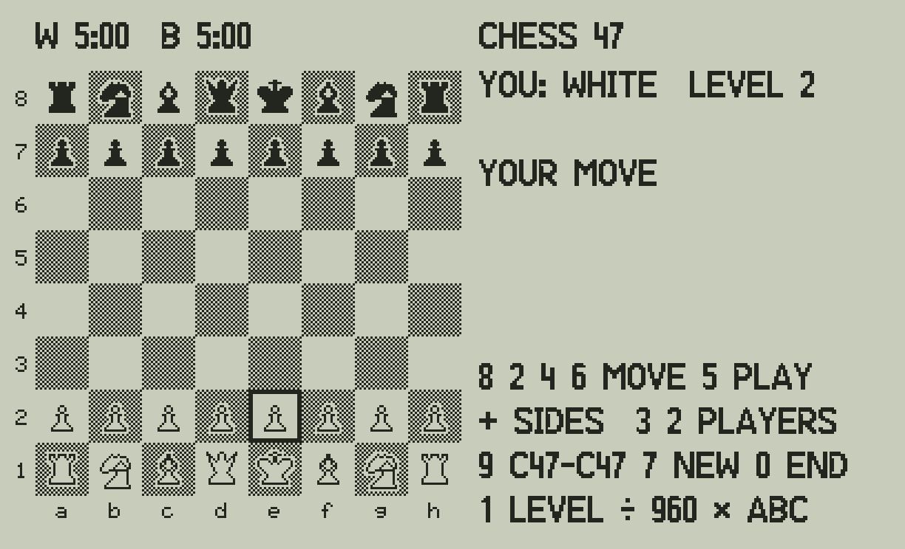
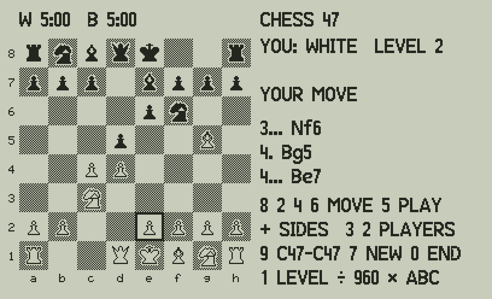
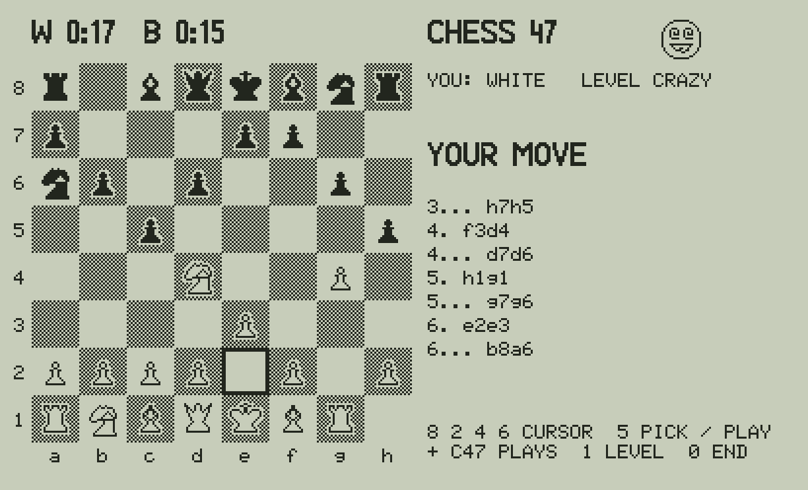
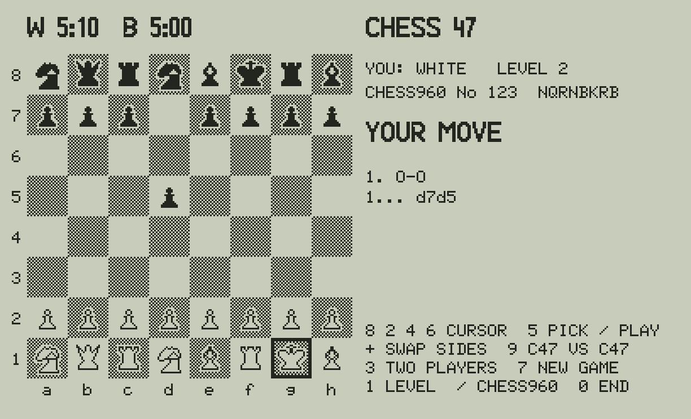

# Chess 47 ♟️

A chess engine for the **C47 / R47** RPN calculator (and the DM42n with the C47 firmware): you play against the
calculator on its own screen. As far as I know, the first chess engine for the C47.

The engine follows the idea of the "matrix" mini engines (Micro-Max, H.G. Muller). The board is a matrix, the
10 × 12 mailbox, and the engine works from it: the move generator, check and mate, and a 2-ply alpha-beta search
with a score kept up to date by every move. v0.2 adds mate detection, the recapture after a capture and the
biggest captures first (it beat v0.1 18.5 to 1.5 in 20 games), an opening book, a chess clock, draws by
repetition and by material, and a CRAZY level of random moves. v0.3 plays the same moves about 3 times faster (a
move at level 2 about 13-19 s instead of 46-55 s, in the simulator's step count), v0.3.4 (the killer move) about 7-12 s:
see *Speed* below. v0.4.0 adds Chess960. v0.5 adds level 3 (three moves ahead, at most 60 s more a move), a new game
that no longer runs out of memory (7), and ÷ in a Chess960 game goes back to normal chess. v0.6.0: × shows the pieces as letters of the firmware's font. v0.7.0 needs a third less memory to start (47.8 KB instead of 71.6 KB) and plays the same moves. v0.7.1: the king no longer steps next to the other king (an illegal move the search could choose). v0.8.0: about 4 times faster on the calculator (estimated): the firmware copies a whole matrix at each element command, so BD became eight small matrices. v0.8.1: levels 4 and 5 (level 3 with 3 and 9 min), about 20 % faster again (`STO J` instead of `STOIJ`), and two builds: `build/draw/` (the pieces drawn, as before) and `build/text/` (the pieces as letters only: about 18 KB, the start needs 31.8 KB instead of 43.8 KB). ÷ 1701 is now chess47.pg5's Kobayashi Maru (the C47 keeps its king and pawns, KIRK WINS), no longer a normal game with a message. **v0.9.0: also for the DM42 / DM42n stock firmware (Free42), experimental**: the same program converted step for step (`tools/build_free42.py`), the same moves and screens; see [docs/FREE42.md](docs/FREE42.md). **v0.10.0: real clocks**: the C47's clock runs too
(its thinking is its time, so the clock gives no side an advantage), the tournament time controls on the key − (5+10,
3+2, 5+3, 10+5, 15+10, 90+30, 90/40+30, NO CLOCK), the clock can be turned off during a game (− and − again: for long
games), the C47 budgets its time per move (level 1 for a move when the time is short), a key moves now at levels 3-5,
the status line shows the search going on (THINKING (2) 8/20) with the C47's clock, and a key pressed while it thinks
is no longer taken as your first key (0 asks END? 0 AGAIN, − CLOCK OFF?). **v0.10.1: the arrows move the cursor again** (in
v0.10.0 they did nothing on the C47: the firmware's `ABS` of a long integer 0 makes `SIGN` answer 1; only 5 worked).

| | |
|---|---|
| Free42 (DM42 / DM42n) | `build/free42/CHESS47.txt` (a Free42 listing; `CHESS47.raw` in the release), experimental: [docs/FREE42.md](docs/FREE42.md) |
| File | `build/CHESS47.txt` (convert with rejig), commented: `build/forum/CHESS47.p47u`, source: `programs_rem/CHESS47.txt` |
| Needs | C47 / R47 firmware with STRUCT, ATEXT, GRFNT, AGRAPH and the bitwise commands (00.109.05.00a0.ALPHA, 5 Oct 2026, or later) |
| Size | drawn (`build/draw/CHESS47.txt`, also `build/CHESS47.txt`): 7 834 steps, about 23.7 KB (.p47, estimated), the start needs 43 800 bytes free (39 000 with a saved game); text (`build/text/CHESS47.txt`, the pieces as letters, no matrix GL, no key ×): 6 681 steps, about 19.6 KB, 31 800 bytes (27 000). While it runs: BB ML ST PT UN KN SB CR (about 1 420 numbers), GL (32 × 24, drawn only), GH (1 × 300), OB (14 × 2), the variables NW NB |
| At the end (0) | your stack and LASTx as before; R00-R19 untouched, R20-R99 cleared; the game kept for the next start (the variables CHN, GH, TW, TB, TOF); the other matrices, TK and the knight words NW NB deleted; CHF kept only when the letters are chosen, TC (the time control) only when it is not 5+10; WSIZE 64, your integer mode back, GRMOD 0, GRFNT 20 |

**The manual, with pictures: [docs/MANUAL.md](docs/MANUAL.md).**

## Playing

`XEQ "CHESS47"`. Setting up takes about 10 s (the tables and the board). You have the white pieces; a game left with
**0** goes on where it was (the moves played again: a few seconds more).

| Key | |
|---|---|
| **8 2 4 6** | the cursor up, down, left, right |
| **5** | pick a piece of yours (shown white on black, on light and dark squares), then **5** on the square to play it; 5 on the same square drops it |
| **+** | swap sides: the C47 plays the side to move and you take the other; at the start: you play black (the board turns, black at the bottom) |
| **9** | C47 vs C47: it plays both sides until checkmate or a draw; any key stops it and you take the side to move (0 ends) |
| **3** | two players: two people play on the calculator; the C47 only checks the moves and calls check, mate and the draws (+ or 9 give it a side again) |
| **7** | a new game of normal chess (the level and your side kept; about 7 s, the glyphs and the tables kept) |
| **÷** | a new **Chess960** game (Fischer random chess): type its number with three digits (066 for 66; 518 is normal chess's start), or ÷ again for a random one; another key goes back. **In a Chess960 game, ÷ goes back to normal chess** (a new game, as 7). The number is shown under your side. Castling: pick the king, then its own rook (the king goes to g or c, the rook to f or d, as FIDE's Chess960 rules); the opening book is not used. 0 keeps the game with its number |
| **×** | the pieces as **letters** of the firmware's font (K Q R B N P white, k q r b n p black; the piece picked white on black), or drawn again. Kept for the next games and the next start (the variable CHF). Ready for the chess font proposed for the C47 firmware |
| **1** | the level, in turn: 2 (2 plies, about 11 s a move, estimated), 1 (1 ply, a few seconds), 0 **CRAZY** (random legal moves at once, a crazy face by the title), **5**, **4**, **3** (level 2 first, then 3 plies for at most 9 min, 3 min or 60 s more: the deeper move when it is found in time, else the best found so far or level 2's; v0.8.1: levels 4 and 5 give the 3 plies the time they need, about 1-5 min in the middle game) |
| **−** | the clock: **before the first move** the time control, in turn: 5+10 → 3+2 → 5+3 → 10+5 → 15+10 → 90+30 → 90/40+30 → NO CLOCK → 5+10 (shown under your side: `- CLOCK 15+10`; kept for the next games and the next start, the variable TC). **During the game** it only asks CLOCK OFF? - AGAIN: − again turns the clock off for the rest of the game (`- CLOCK OFF`, the clocks then count each side's time up); any other key says no and does nothing else |
| **0** | the end; the game is kept and goes on at the next start (not when it is over) |

The rules are all there: castling (not out of, through or into check), en passant and promotion (always to a queen).
CHECK, CHECKMATE, STALEMATE, DRAW: REPETITION (the same position the third time, the same side to move) and DRAW: MATERIAL
(kings only, or one bishop or knight) are shown; there is no 50-move rule. An illegal move is refused (ILLEGAL MOVE, or
ILLEGAL: CHECK when it leaves your king attacked). The last seven moves are listed on the right in standard algebraic notation, as in a book or a
scoresheet: e4, Nf3, exd5, Nbd2, R1e2, O-O, e8=Q, Qh7+, Ra8#. The clock at the top
left shows each side's time left (h:mm:ss from an hour on). **Both clocks run, the C47's too** (v0.10.0; before, only
a person's ran and the C47 never lost on time): the time it thinks is its time. The time control is chosen with −
before the first move (5+10 by default: 5 minutes each, 10 seconds more for every move played, a Fischer clock; the
FIDE controls 15+10 rapid, 90+30 and 90/40+30 classical, the blitz 3+2 and 5+3, 10+5, or NO CLOCK). 90/40+30 gives
30 minutes more after each side's move 40. The side whose time runs out loses (WHITE / BLACK LOST ON TIME), the C47
too, unless the opponent cannot mate by any
series of legal moves (FIDE 6.9: a bare king, a lone knight against only king and queens, bishops all on one colour
with no pawn or knight): then DRAW: TIME, NO MATE. Setting
up, turning the board (+) and drawing a move played are nobody's time; the clock stops when the game is over and is
kept with a saved game. With the clock off (NO CLOCK, or − − during a game) nobody loses on time and the clocks count
each side's time used.

**How the C47 uses its time** (LBL :TBUD:): a budget for each move, its time left over the moves to go (30; with
90/40+30 the moves left to move 40, plus 2) plus the seconds a move, at most a quarter of its time left. Level 2's
search cannot stop halfway (about 10-20 s a move on the calculator), so when the budget is below 15 s that move is
played at level 1 (THINKING ... (LEVEL 1); the level shown stays yours); levels 3-5 give their third ply the budget
less the time level 2 took (never more than their 1, 3 or 9 minutes). So the levels keep their strength when there is
time (15+10 and the classical controls: level 2 every move; 90+30 at level 5: about 3 minutes a move early on) and the
C47 does not lose on time at the faster ones (3+2 and 5+3: mostly level 1). With the clock off they think as before.

**While the C47 thinks.** The status line shows the search: THINKING (the level searched) and the root move it is
on, of how many (`THINKING (2) 8/20`), and the C47's clock runs down on the screen, at most once a second
(LBL :LIFE:, between root moves). **At levels 3-5 any key means "move now"**: LBL :TIME3: (its time check) reads it,
and the C47 plays the best move found so far (level 2's move when the third ply has not finished one); the key does
nothing else. Level 2 cannot stop halfway.

**Keys pressed while the C47 thinks.** The firmware keeps the last key pressed while a program runs (it looks at the
keyboard every 128 ms) for the next `KEY?`. Before v0.10.0 that key was taken as your first key when your turn came
(a 5 or an arrow pressed while waiting moved the cursor or picked a piece by itself). Now it is read when the C47
has moved (`KEY? 99`) and dropped, except two keys that get a question: **0** asks **END? 0 AGAIN** (0 again ends
and keeps the game; any other key only says no), **−** asks CLOCK OFF? as on your turn. Nothing moves by itself and
nothing ends without a second key. Before CLOCK OFF? the key is dropped too (so − − typed fast cannot turn the clock
off: the second − must come after the question). A key is never read twice: `PAUSE` waits for the key to be
released, and so does the firmware's key check while the program runs. In C47 vs C47 (9) a key still stops it (at
levels 3-5 the first key makes it move now, a second one takes the side to move).

The C47 opens from its book (python/book.py: 14 main lines, Ruy Lopez to Réti, 10 plies each) as long as the game
follows one of them, choosing at random among those that fit; then it thinks.

**Strength:** v0.1 by my estimate about 800-1100 Elo; v0.2 beat v0.1 18.5-1.5 in 20 games (the Python twins), so
perhaps 1100-1300. Measured (`tools/elo47.py --ladder`, `docs/ELO.md`: against Stockfish 1320, weakened
Stockfish and a material player; Stockfish's UCI_Elo scale, engine blitz, not FIDE). v0.8.1 (Nov 19, 440 games,
Stockfish dev-20260930): level 3 searched to the end about **1325** (95 %: 1245-1412), level 5 (9 min) about **1307**,
level 4 (3 min) about **1271**, level 3 with the C47's 60 s about **1262**, level 2 about **1071**, level 1 about 933.
The earlier ladder (another Stockfish build) put level 3 at 1100 and level 2 at 980: the scale moves with the build, the
gaps between the levels are what to compare. Levels 4 and 5 are worth about 10 and 45 over level 3's 60 s: 3 and 9 minutes
let it finish more of the middle-game positions (they need 160-2 760 answers, at about 12.7 answers a second on the C47:
`tools/speed47.py`). 8 games a pair keep the intervals wide (+-100). It sees mates in one, one-move tactics and the recapture; it
misses deeper tactics. The matches against an independent player in the simulator: `docs/MATCHES.md`.

## On the computer, with Chess960 (`tools/play47.py`)

A trial version for the computer: the C47's screen (the same glyphs, fonts, places and LCD colours), the same engine
(`python/chess47ref.py`), the same keys and rules, and Chess960 (Fischer random chess, in CHESS47 too since v0.4.0).

    pip install pygame
    python3 tools/play47.py          (--new for a new game; else the last one goes on, kept in ~/.chess47_play.json)

`/` starts a Chess960 game: type its number 0-959 and Enter (Enter alone: a random one; 518 is normal chess). Castling
in Chess960: pick the king, then its own rook (the king goes to g or c, the rook to f or d). The book is for normal
chess only. The engine's Chess960 (`python/chess960.py`, a subclass of the twin, which is not changed) is checked
against python-chess by `tests/test_960.py`: the 960 start positions, perft, and the legal moves at every ply of 300
random games (castling included).

## How it works

- **Small matrices, each its own** (v0.8.0, `python/layout.py` MATS). On the C47 every element command (`STOIJ`,
  `RCLEL`, `STOEL`, `STOSEQ`, `RCLSEQ`, even `J+`) copies the whole indexed matrix, and back for a write (`STOIJ`
  counts as one): LOCT47 measured `RCLEL` at 550 µs on a 1 × 120 matrix and 5 000 µs on 14 × 120, while `INDEX` costs
  175 µs (docs/DEVOPT.md). So the one matrix BD of v0.4-v0.7 is now eight; each `STOIJ` has the `INDEX` of its matrix
  before it, and the board's is the default:
  - BB (1 × 120), the board: the 10 × 12 mailbox (a1 = 22 … h8 = 99, the border 8). A piece is 1-6 (pawn, knight,
    bishop, rook, queen, king), positive for white and negative for black. A move is from × 1000 + to;
  - ML (3 × 120), the move lists (the root, the replies, the moves played);
  - ST (1 × 18), the state (the killer move, the Chess960 squares, level 3's search);
  - PT (7 × 78), the score table: white's value of each piece on each square (material + a piece-square table), row
    1 the empty piece's zeros, column the square - 21. The piece-square values are the same on both wings, so
    black's table is white's turned round: value(-t, s) = -value(t, 121 - s), read at the column 39.5 + c (s - 60.5)
    for the colour c = ±1. Each move updates SC from three or four lookups, and SC is never recomputed;
  - UN (3 × 6), the undo data of each ply;
  - KN, SB, CR (1 × 120 each), the knight masks, the bit of each square (below) and the masks of the castling rights.
- **The search:** 2 plies with alpha-beta cuts. The moves come out of the generator ordered: the captures by the
  value taken, queen first (an insertion as they are added), then the others. A move that lets the king be taken
  scores about -20000, so the search never chooses one. A checking move after which the other side has no legal
  move is a mate (29000). A capture reply is played and answered by its recapture when the square is attacked;
  the other replies are not played: their effect on SC is worked out directly. The replies are valued as they are
  generated, starting from the replying side's own back rank, and the generator stops at the first one that refutes.
- **The 64-bit bitwise commands:**
  - the castling rights are one 4-bit word (`AND` clears a right, `BS?` tests one);
  - the dark squares are computed from the glyphs: dither `AND NOT` mask `OR` glyph (WSIZE 24, a 24-pixel column is one
    `AGRAPH` word), so only one set of glyphs is stored;
  - each position after a move gets a 32-bit key, Zobrist style: one word for each piece on its square, `XOR`ed together
    (WSIZE 32); the keys of the game find the threefold repetition: the record GH holds key × 100 000 + move in one
    number a ply (one row; a saved game of v0.6.0, two rows, is read the same way and written again as it is replayed);
  - the knights of each side are a 64-bit word (NW, NB: bit 8 (rank - 1) + file - 1), kept by every move and its
    take-back with `XOR`; "is this square attacked by a knight" is one `AND` with the square's knight mask (the matrix KN)
    instead of eight probes.
- **The other matrices:** the glyphs GL, the game record GH, the opening book OB (five book moves to a number).
- **The build** writes out the macros of the source (`DEF :NAME:` … `ENDDEF`, used with `USE :NAME:`) where they are
  used, so code inlined for speed is still written once, and the constants `@NAME` (the rows, offsets and sizes of the matrices, the memory the
  start checks).
- **Not used:** EIGEN and the 34-digit precision don't make a chess engine stronger, so they are not forced in.
  The plans are in `DEVELOPMENT_NOTES.md`.

## Speed (v0.5.0)

The same moves and the same values as v0.2 (the Python twin is unchanged), counted in simulator steps over three
middle-game positions at level 2 (0.17 ms a step on the C47):

| | steps | a move |
|---|---|---|
| v0.2 | 872 000 | 46-55 s |
| the replies valued as generated, from their own side, the cut at the first refutation | 296 000 | |
| the capture replies valued without being played; a tighter ray loop for the attack test | 283 000 | |
| one matrix BD for the board, the lists, PT and the undo data (no INDEX switching) | 279 000 | (fewer steps, but slower on the C47: undone in v0.8.0) |
| the knight attack test with bitboards (`AND`), the square bits read from a table | 270 000 | |
| the scan of the squares counted with `DSE` (the end test one step instead of nine) | 262 000 | |
| **v0.3** (h8's bit kept signed, below) | **263 000** | **13-19 s** |
| v0.3.3 (the same search; the clock, the move list in SAN) | 253 000 | |
| **v0.3.4**: the killer move: the reply that refuted the last root move is tried first (when it is still a move), before any reply is generated; when it refutes this one too, no reply is generated at all | **203 000** | **7-12 s** |

| **v0.5.0**: ADD reads the target through the index its caller set and checks the list's room only in the list modes; GEN tests an own piece with one `X>0?`; DELTA takes from and to from R30 R33; VAL inlined in DELTA and MAKE; ATT's diagonals and lines in two loops; GPAWN, GSLIDE and 8 other routines inlined (10 local labels freed) | 15 positions: 901 000 -> 839 000 (93 %) | **6-11 s** |

| **v0.8.1**: `STO J` (and `STO I`) instead of `STOIJ` (the firmware's STOIJ copies the whole matrix back), the knights' masks with `STOSEQ`, INDEX out of 8 board-only loops | estimated 13.7 s → 11.0 s a move; 7 742 → 7 424 steps | about 20 % faster (to be confirmed: `STO J` on the C47) |
| **v0.8.0**: BD split into eight small matrices (the firmware copies the whole matrix at each element command) | 5 positions: 314 000 steps (+5 %: the INDEX steps); the time estimated with LOCT47's costs (`python/time47.py`): 53.5 s → 13.7 s a move | about 4 x faster (to be timed on the C47) |
| **v0.7.0**: BD 23 → 14 rows (PT white's only, the undo data in PT's free columns), GH one row, OB packed: 23.8 KB less at the start; DELTA and MAKE read the column of the target once | 22 positions: 1 443 000 -> 1 505 000 (+4.3 %) | about the same |

The killer move over 15 positions (these three, two of the tests, ten of random games): 1 407 000 steps -> 915 000
(65 %: about 16 s -> 10 s a move on average), the same move and value in each.

Tried and left out, as they cost as much as they saved: sorting the root moves before the search (`QSORT`), a list
of the pieces or occupancy bitboards for the scan (keeping them up to date in every move and take-back costs about what
the scan saves), and (v0.3.4) a futility bound on the quiet replies (in the twin 40 % fewer replies valued, in the
program 5 % slower: computing the bound costs more than the few replies it skips once the cut comes early).

## Tested

In the C47 simulator only (`python/c47sim.py`, from Almanac 47), with `python3 tests/test_chess47.py`. The test checks
against `python/chess47ref.py`, the same engine in Python:

- the move generator gives the same moves, in the same order, for 12 positions: castling, en passant, promotion, pins;
- the reference generator gives the published perft counts (20 / 400 / 8 902 / 197 281 from the start, Kiwipete,
  position 3), with promotions to a queen only;
- the search gives the same move and value at levels 1 and 2 (mates in one found);
- a game of the C47 against itself: the book moves are from its lines, then move for move the same, with the same
  board and score; 20 CRAZY moves all legal; the clock runs;
- the clock (v0.10.0): − cycles the 8 time controls before the first move and sets both clocks; the control is kept
  between starts; − − during the game turns the clock off (the clocks count up), − then 0 does not (and does not end
  the program); the C47's clock runs and it loses on time with 0.1 s left; with 3+2 it plays a move at level 1 (the
  same move as the twin's search(1)), with 5+10 and NO CLOCK at level 2; LBL :TBUD:'s budgets for the controls;
  keys pressed while it thinks (the simulator's `typed`): 0 asks END? (0 again ends, another key says no), − asks
  CLOCK OFF?, 5 is dropped; at level 3 a key moves now (level 2's move, in a seventh of the time);
- 10 matches against an independent python-chess player (`tools/match47.py`): every move legal, the board right
  after every move, every game ended as the rules say;
  v0.10.0: the same 10 games with NO CLOCK (9.5 / 10, docs/MATCHES.md) and with 5+10 (the C47 at level 2 every move:
  the same games, 9.5 / 10, docs/MATCHES_TC0.md); 3+2 (mostly level 1 for lack of time, no loss on time): 8 / 10,
  docs/MATCHES_TC1.md (`--tc N`; match47 now keys the opponent's moves on the turned board when the C47 has white: since
  + turns the board its games as white could not go on);
- moves keyed with 5 and the arrows work, and illegal moves are refused; the cursor and the piece picked show on a
  dark square; + turns the board; 9 plays on until a key; a game left with 0 comes back the same (also one saved by v0.6.0); 7 starts again;
- the start screen matches `python/layout.py`'s picture pixel for pixel.

**The integer mode.** CHESS47's words are bit patterns: the repetition keys up to 2^32 (WSIZE 32), the glyph columns
up to 2^24 (WSIZE 24), the knight words up to 2^64. In `2COMPL`, the C47's default, `SINT` refuses a value with the
top bit set (**Out of range**: the error of the first run on the calculator, Oct 26). So CHESS47 runs in `UNSIGN`
(Victor's C47: `UNSIGN` `WSIZE 32` `4294967295 SINT` runs) and gives you back your own mode at the end: at the start it
reads it (at WSIZE 8, `1 SINT NOT →REAL` is 254 in UNSIGN, -2 in 2COMPL, -1 in 1COMPL, -126 in SIGNMT) and keeps it in
the local register R.09. The simulator now refuses SINT out of range as the C47 does.

`AND`, `OR`, `NOT`, `XOR`, `BS?` ran on the calculator in Logic 47, `UNSIGN` / `2COMPL` on Victor's C47; `→REAL`,
`1COMPL` and `SIGNMT` are still to be confirmed there. `0 STO+ "CHN"` (it creates the variable the first time) ran in
Almanac 47's MOON47. New in v0.10.0, still to be confirmed on the C47: `RCL+` / `RCL-` with a named variable (`RCL+ "TOF"`,
`RCL- "TB"`; `RCL× "name"` ran in Almanac 47); `KEY? 99` right after the C47's move to drop a key pressed while it
thought, and `KEY? 47` in LBL :TIME3: (move now) (the firmware's `lastKeyCode`, read from the source: to try by
pressing 5, 0 or − while it thinks); the 14-digit
numbers of the time-control tables (`90901510050305`) as program steps.
New in v0.8.1, still to be confirmed on the C47: `STO J` / `STO I` as the matrix index (instead of `STOIJ`: the
firmware's `RCLEL` reads the registers I and J, so it should; LBL :BUDG:'s `Y^X` for levels 4 and 5).
New in v0.7.0, still to be confirmed on the C47: the opening book's numbers of up to 25 digits
as program steps (five moves to a number; each is stored with `STOSEQ` into the real matrix OB, as v0.6.0's
five-digit moves were). New in v0.6.0, still to be confirmed on the C47: `MEM#` (the free RAM, checked at
the start) and `ATEXT` with `GRMOD 2` (the halo of the letters on the dark squares, the key ×).

## Files

| | |
|---|---|
| `docs/MANUAL.md` | the manual, with the screens (`tools/manual47.py` makes them in `docs/manual/` from the keys) |
| `programs_rem/CHESS47.txt` | the commented source (STRUCT, named labels) |
| `tools/build_chess47.py` | writes `programs/`, `build/` and `listings/`, and `build/forum/CHESS47.p47u` |
| `build/forum/CHESS47.p47u` | the commented file for the forum and the C47's PROGRAMS folder: how to use it in plain words, then the code with its comments in `@` lines (rejig does not compile them: no REM steps); its narrative is `tools/forum/CHESS47.txt` |
| `tools/build_p47.py` | on your computer with rejig: `build/p47/CHESS47.p47` from the forum file (`--validate=r47`), checked byte for byte against the plain listing's |
| `python/layout.py` | the board's place, the piece glyphs, the crazy face (the build writes their words into the program) |
| `python/book.py` | the opening book (the build writes it into the matrix OB) |
| `tools/elo47.py` | the rating: CHESS47's engine (the twin: the calculator's moves) against Stockfish at fixed strengths (UCI_Elo), refereed by python-chess; the rating by maximum likelihood with its 95 % interval, `docs/ELO.md` and the games in `docs/ELO_games.pgn` |
| `tools/speed47.py` | level 3's answers a second on the C47 (the simulator and `python/time47.py`): the budgets of levels 3, 4, 5 in `tools/elo47.py` |
| `tools/match47.py` | matches in the simulator against a python-chess player, written to `docs/MATCHES.md` |
| `tools/selfplay47.py` | the rules check (python-chess): the C47 against itself, 5 games at each level by default; every move legal, the board after it, every end of game (mate, stalemate, repetition, material, time-out) as the rules say; `docs/SELFPLAY.md` |
| `python/chess47ref.py` | the engine in Python, step for step as the program, and perft |
| `python/chess47sim.py` | runs the program in the simulator and writes the screens in `docs/` |
| `python/c47sim.py`, `stdfont.py`, `tinyfont.py` | the C47 simulator and fonts, from Almanac 47; the bitwise commands from Logic 47 |
| `tools/play47.py` | Chess 47 on the computer (pygame), with Chess960 |
| `python/chess960.py`, `tests/test_960.py` | Chess960 on the twin's engine (a subclass): the twin of CHESS47's Chess960 games (the same castling moves in the same places), checked against python-chess |
| `tests/test_chess47.py`, `tests/test_forum.py` | the tests above; the forum file (its steps = the listing's, no REM, the narrative) |

## Author

By Victor Valdes (valdes.vj@gmail.com),

Thank you to the C43/C47 firmware developers and SwissMicros. Written with the help of AI. See `AI_ASSISTANCE.md` for
the responsible-use statement.

## License

Published under the [GNU General Public License v3.0](LICENSE). Free to use, modify, and share for the calculator
community.
