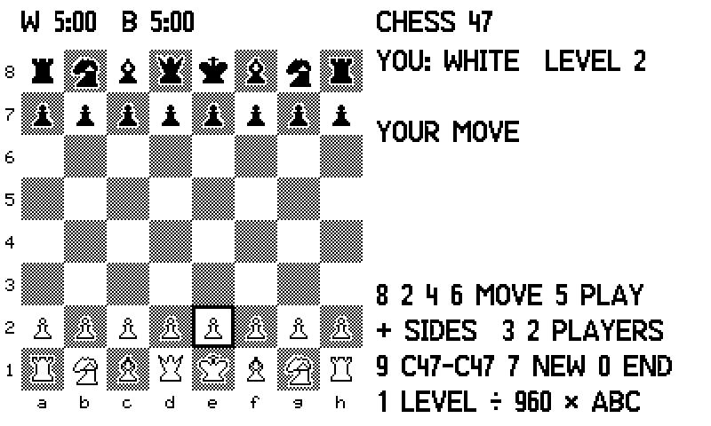
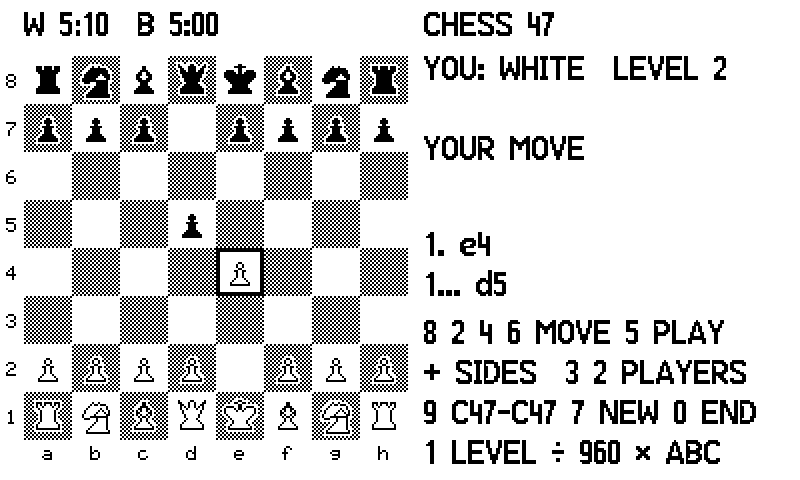

# CHESS47 for Free42 (DM42 / DM42n stock firmware): experimental

The same program as the C47's drawn build, converted for Free42 3.3 with the DM42's 400 × 240 graphics
(`3 STO "GrMod"`). The engine plays the same moves as on the C47, and the screens match the C47 simulator
pixel for pixel, except the clock.

 

## How it is made

`python3 tools/build_chess47.py` builds the `f42` variant (`build/f42/`): the drawn build plus the source's
`REM ==== IF F42` sections (only DRAWSQ: the square drawn by `zSQ`). `python3 tools/build_free42.py` converts it
into `build/free42/CHESS47.txt`, a Free42 listing:

| C47 | Free42 |
|---|---|
| IF / ELSE / ENDIF, DO / WHILE / ENDDO (255 a program) | the opposite test and GTO to local labels |
| 89 local labels in one program | each routine a global label (`LBL "GEN"`), its own program with labels 00–99 |
| STO J (I = 1 in Y) / STO J X<>Y STO I X<>Y | STOIJ (Free42 reads an element directly: no matrix copy) |
| STOSEQ, RCLSEQ | STOEL J+, RCLEL J+ |
| UNSIGN, WSIZE n, SINT, →REAL | BSIGNED off (flag 78), `zWSn` (WSIZE, the stack kept), nothing |
| ATEXT, GRMOD, GRFNT, AGRAPH r | `zAT` (the C47 fonts as AGRAPH strings), `zGM`, `zFN`, `zAG99` |
| KEY? r, PAUSE n, TICKS | `zKQr` (GETKEYA), `zW` (TIME), `zTK` |
| "text" (a string in X), x→α, αIP | XSTR, `zXAr`, `zAIr` (XASTO) |
| R-CLR, STO+ of a missing variable, BS? IND r | `zRC`, `zP…` / `zM…`, `zBSr` |

The fonts and the glyphs are strings of column bytes in registers R100–R1299 (`zDAT` writes them at the start;
`SIZE 1300`), read with RCL IND, so the program's INDEX is never disturbed.

## Testing

`sh tools/f42/setup.sh` builds `tools/f42/f42run`: the Free42 core of the DM42 (SwissMicros' fork) with the
Intel decimal library (34 digits, as the calculator: the 64-bit knight masks are exact) and the 400 × 240 screen,
run headless. `python3 tests/test_free42.py`: every step pasted, level 2 and 3 against the twin
`python/chess47ref.py`, and the screens against the C47 simulator.

## On the calculator (not tried yet)

1. `python3 tools/build_chess47.py && python3 tools/build_free42.py`
2. `printf 'paste build/free42/CHESS47.txt\nexport build/free42/CHESS47.raw\n' | tools/f42/f42run`
3. Copy `build/free42/CHESS47.raw` to the DM42's flash disk, load it (Setup ▸ Load program), `XEQ "CHESS47"`.

Things to check on the DM42: that it loads (113 programs, about 13 000 steps, and 1 300 registers of data: the
memory may be short), the speed of a level-2 move, the keys, and the clock. Not there yet: the rules of
chess47.pg5 (promotion to rook / bishop / knight, the 50-move rule, draw offers and resigning).
