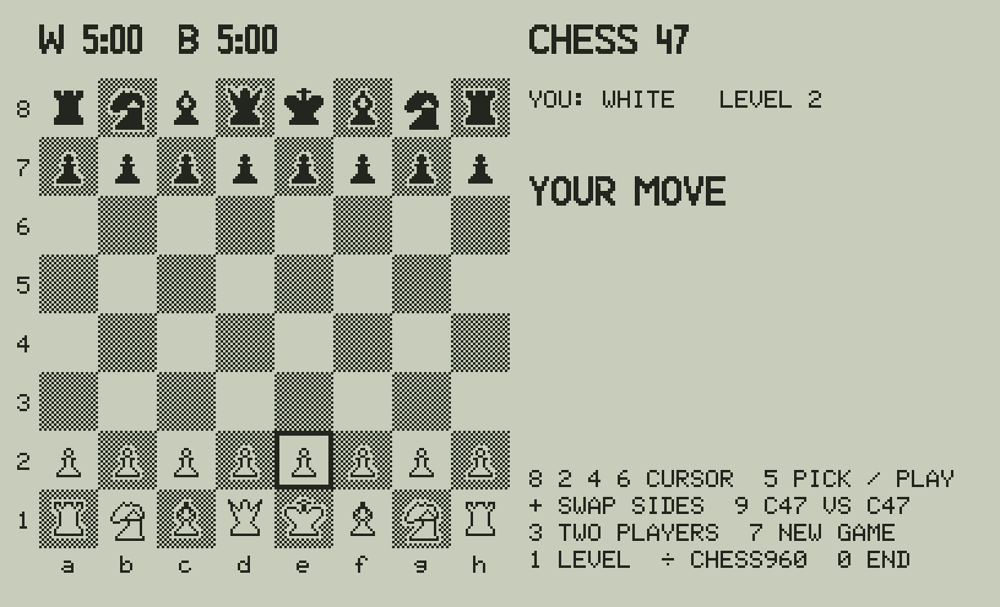
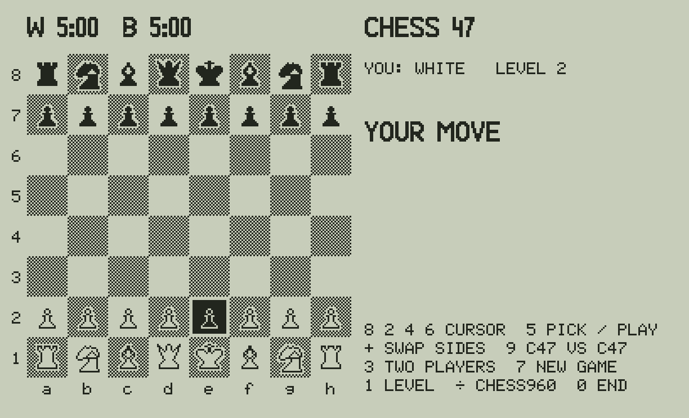
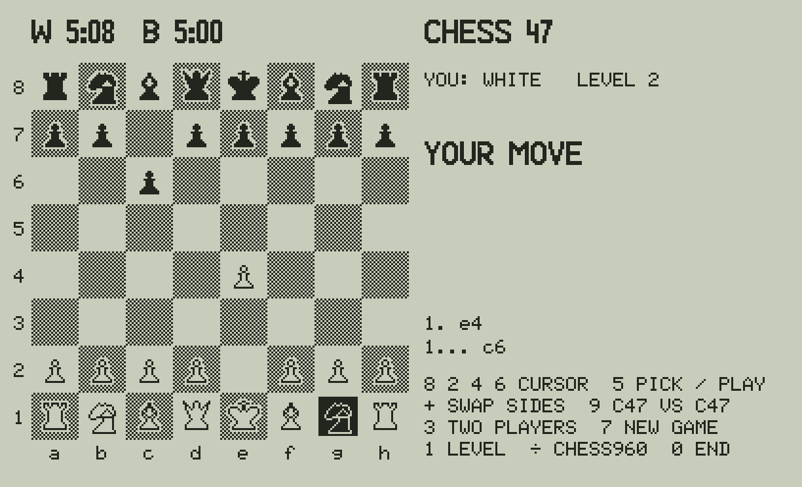
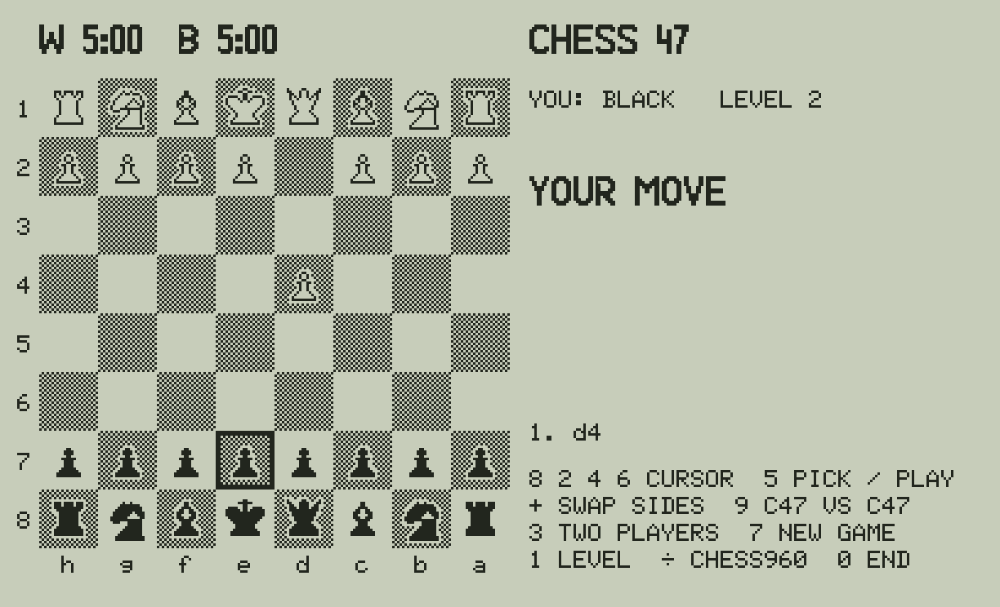
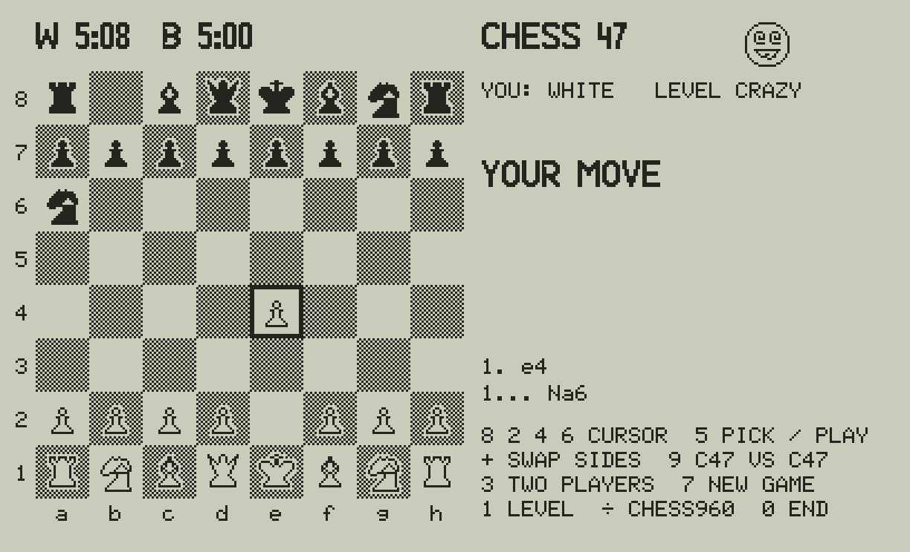
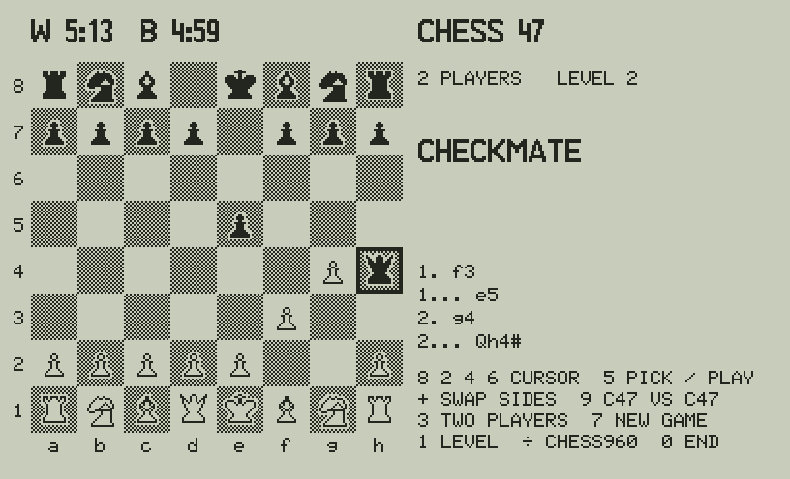
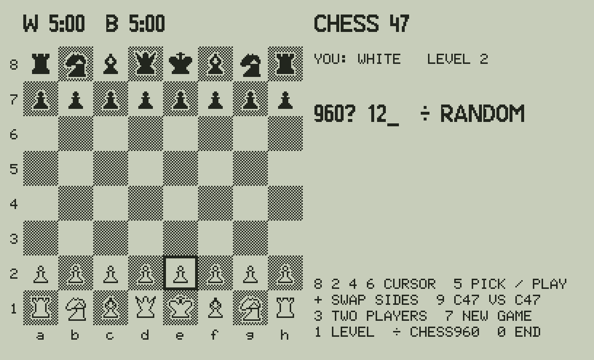
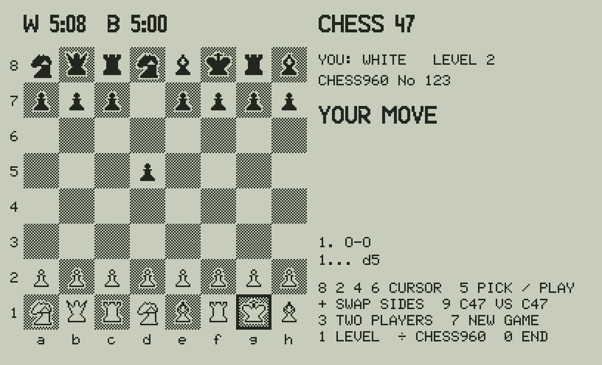

# Chess 47: the manual

Chess against your C47 (or R47, or a DM42n with the C47 firmware): the board on the screen, the pieces moved with
the number keys, all the rules of chess, a 5-minute clock, two players or the C47 against itself, and Chess960.
Version 0.4.0. (The pictures are the C47 simulator's screens, made from the keys by `tools/manual47.py`.)

## Starting

Load `CHESS47.p47` as you load your other programs (`python3 tools/build_p47.py` makes it from the forum file with
rejig), then **XEQ CHESS47**. Setting up takes about 10 seconds. You have the white pieces and it is your move; the
cursor (a frame) is on e2.

The right side shows your side and the level, whose move it is (or CHECK, CHECKMATE ...), the last seven moves and
the keys. The clock at the top left is each side's time left.

## Moving a piece

Move the cursor with **8 2 4 6** (up, down, left, right, as you see the board) and press **5** on your piece: it is
shown inverted (white on black). Move the cursor to its square and press **5** again. 5 on the same square puts the
piece back. A move that is not legal is refused (ILLEGAL MOVE, or ILLEGAL: CHECK when it leaves your king attacked).

Castling: the king two squares (e1-g1 or e1-c1); the rook follows. En passant: the pawn to the empty square behind
the pawn it takes. Promotion is always to a queen.

The C47 answers: from its opening book in the first moves (14 known lines, chosen at random among those that fit),
then it thinks: about 7-12 seconds a move at level 2, a few seconds at level 1.

The moves are listed in standard algebraic notation, as in a book: `e4`, `Nf3`, `exd5`, `Nbd2` (which knight),
`O-O`, `e8=Q`, `Qh7+` (check), `Ra8#` (mate).

## The keys

| Key | |
|---|---|
| **8 2 4 6** | the cursor up, down, left, right |
| **5** | pick a piece, then play it (5 on the same square drops it) |
| **+** | swap sides: the C47 takes the side to move and you the other. At the start: you play black (the board turns) |
| **9** | C47 vs C47: it plays both sides to the end; any key stops it and you take the side to move |
| **3** | two players: the C47 only checks the moves and calls check, mate and the draws (+ or 9 give it a side again) |
| **1** | the level: 2 (two moves ahead), 1 (one move ahead), CRAZY (random legal moves) |
| **7** | a new game of normal chess (the level and your side kept) |
| **÷** | a new Chess960 game (below) |
| **0** | the end: an unfinished game is kept and goes on at the next XEQ CHESS47 |

 

*Left: + at the start, you play black (the board turned). Right: the CRAZY level, its face by the title.*

## The end of the game

CHECKMATE and STALEMATE; DRAW: REPETITION (the same position the third time, the same side to move) and DRAW:
MATERIAL (kings only, or one bishop or knight). There is no 50-move rule.

*Two players (3): 1. f3 e5 2. g4 Qh4#.*

## The clock

Each side has 5 minutes and gets 10 seconds more for every move (a Fischer clock). Only a person's clock runs: the
C47's stops while it thinks, so it never loses on time. When your time runs out you lose (WHITE / BLACK LOST ON TIME),
unless your opponent could not mate by any series of legal moves (a bare king, for example): then it is a draw
(DRAW: TIME, NO MATE), as the FIDE rules say.

## Chess960

Chess960 (Fischer random chess): the pieces of the back rank start in one of 960 positions, the bishops on squares
of both colours and the king between the rooks; everything else is chess. Press **÷** and type the position's number
with three digits (066 for 66), or **÷** again for a random one; any other key goes back. 518 is the normal start.

The number is shown under your side. The opening book is not used. **To castle, pick the king and then its own
rook**: the king goes to g (with the rook on its right) or c (on its left), the rook to f or d, as in normal chess.
The squares between them must be empty and the king may not be in check, pass through check or land in check.

*Chess960 No 123 (NQRNBKRB): 2 6 5 6 5, the king f1 onto its rook g1: O-O, the king on g1, the rook on f1.*

0 keeps a Chess960 game with its number; 7 goes back to normal chess.

## What it changes on your calculator

Your stack and LASTx come back at the end. R00-R19 are not touched; R20-R99 are used and cleared at the end. WSIZE is
64 and your integer mode is given back. The game is kept in the variables CHN, GH, TW and TB (delete them to forget it);
the matrices it uses while running are deleted at the end. One program, CHESS47, with one global label.

On the computer, `tools/play47.py` is the same game with the same screen and keys (`pip install pygame`).
