# Chess 47: the manual

Chess against your C47 (or R47, or a DM42n with the C47 firmware): the board on the screen, the pieces moved with
the number keys, all the rules of chess, a chess clock with the tournament time controls (or none), two players or
the C47 against itself, and Chess960.
Version 0.10.0. (The pictures are the C47 simulator's screens, made from the keys by `tools/manual47.py`.)

## Two versions

The release has CHESS47 twice; load the one you like (both are called CHESS47 and play the same moves):

| | drawn pieces (`draw`) | letters only (`text`) |
|---|---|---|
| the pieces | drawn, or letters with **×** | letters of the calculator's font (K Q R B N P, k q r b n p) |
| the program | 7 834 steps, about 23.7 KB | 6 681 steps, about 19.6 KB |
| free memory to start | 43.8 KB (39.0 KB with a saved game) | 31.8 KB (27.0 KB) |

The letters version has no key **×** and no drawings: it is for a calculator that has less memory free.

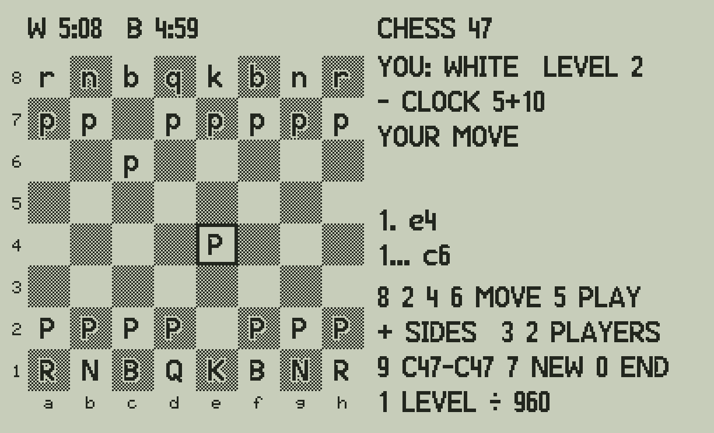

*The letters version: e2-e4 and the C47's reply.*

## On the DM42 / DM42n (Free42)

The same game also runs on the DM42's own firmware (Free42): `CHESS47.raw`, loaded as a program, then
`XEQ "CHESS47"`. The keys, the screens and the moves are the same as here. It is experimental: see
[FREE42.md](FREE42.md).

## Starting

Load `CHESS47.p47` as you load your other programs (`python3 tools/build_p47.py` makes it from the forum file with
rejig), then **XEQ CHESS47**. Setting up takes about 10 seconds. You have the white pieces and it is your move; the
cursor (a frame) is on e2.

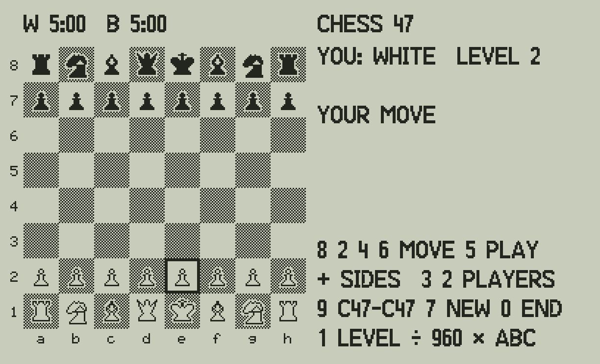

The right side shows your side and the level, whose move it is (or CHECK, CHECKMATE ...), the last seven moves and
the keys. The clock at the top left is each side's time left.

## Moving a piece

Move the cursor with **8 2 4 6** (up, down, left, right, as you see the board) and press **5** on your piece: it is
shown inverted (white on black). Move the cursor to its square and press **5** again. 5 on the same square puts the
piece back. A move that is not legal is refused (ILLEGAL MOVE, or ILLEGAL: CHECK when it leaves your king attacked).

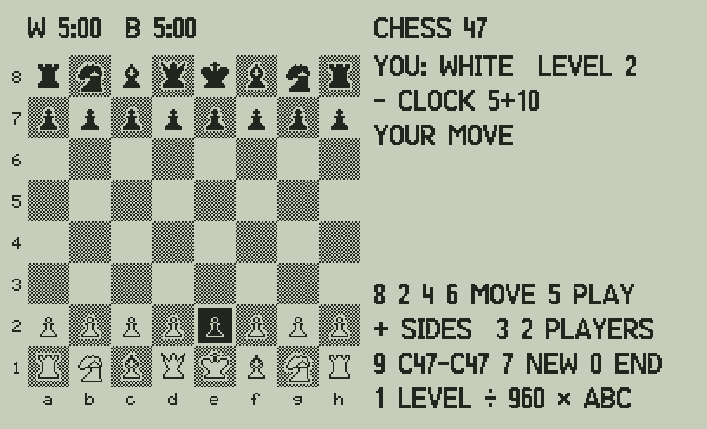

Castling: the king two squares (e1-g1 or e1-c1); the rook follows. En passant: the pawn to the empty square behind
the pawn it takes. Promotion is always to a queen.

The C47 answers: from its opening book in the first moves (14 known lines, chosen at random among those that fit),
then it thinks: about 11 seconds a move at level 2 (estimated), a few seconds at level 1.

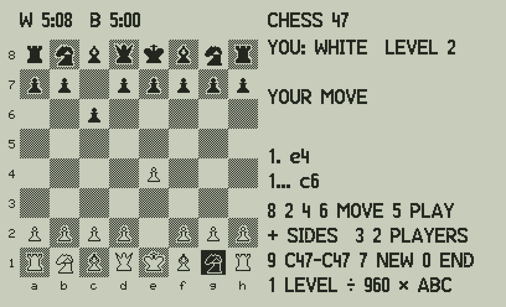

The moves are listed in standard algebraic notation, as in a book: `e4`, `Nf3`, `exd5`, `Nbd2` (which knight),
`O-O`, `e8=Q`, `Qh7+` (check), `Ra8#` (mate).

## The keys

| Key | |
|---|---|
| **8 2 4 6** | the cursor up, down, left, right |
| **5** | pick a piece, then play it (5 on the same square drops it) |
| **+** | swap sides: the C47 takes the side to move and you the other. At the start: you play black (the board turns) |
| **9** | C47 vs C47: it plays both sides to the end; any key stops it and you take the side to move |
| **3** | two players: the C47 only checks the moves and calls check, mate and the draws (+ or 9 give it a side again) |
| **1** | the level, in turn: 2 (two moves ahead), 1 (one move ahead), CRAZY (random legal moves), 5, 4, 3 (three moves ahead, at most 9 minutes, 3 minutes or about a minute more a move: the longer the stronger) |
| **7** | a new game of normal chess (the level and your side kept; about 7 seconds) |
| **÷** | a new Chess960 game (below); in a Chess960 game: back to normal chess (a new game, as 7) |
| **×** | the pieces as letters, or drawn again (below) |
| **−** | the clock (below): before the first move the time control, in turn; during the game CLOCK OFF? (− again: off) |
| **0** | the end: an unfinished game is kept and goes on at the next XEQ CHESS47 |

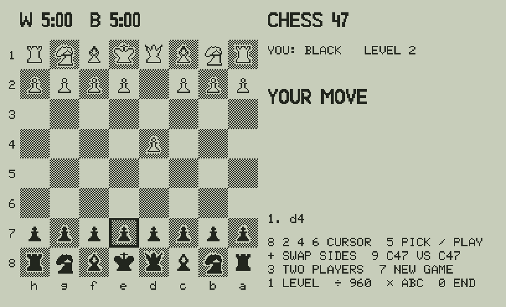 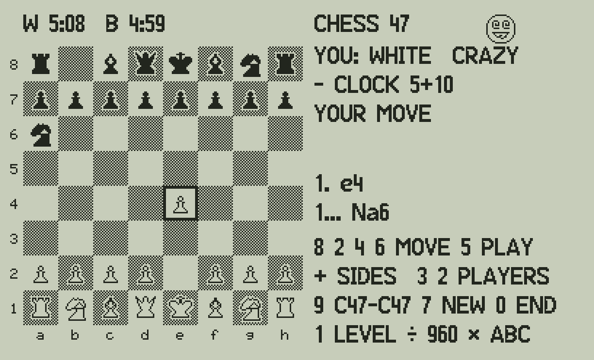

*Left: + at the start, you play black (the board turned). Right: the CRAZY level, its face by the title.*

Levels 3, 4 and 5 search three moves ahead (your move, its answer, your reply). Level 3 stops after about a minute
and plays the best move found so far; level 4 has 3 minutes and level 5 9 minutes, so they finish the search far
more often (in middle-game positions the full search takes about 1 to 4 minutes). It thinks the full time only when
it needs it.

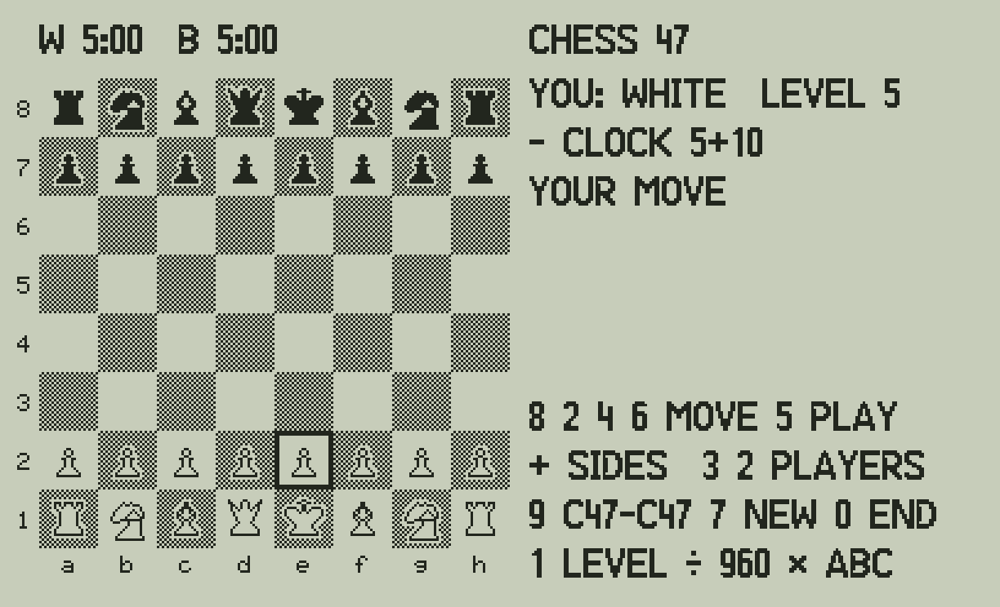

*1 three times: level 5.*

## The pieces as letters

In the drawn-pieces version, **×** shows the pieces as letters of the calculator's own font instead of the drawings: **K Q R B N P** are the white
pieces, **k q r b n p** the black ones (as in a FEN). **×** again brings the drawings back. The piece picked is
white on black. The choice is kept for the next games and the next start.

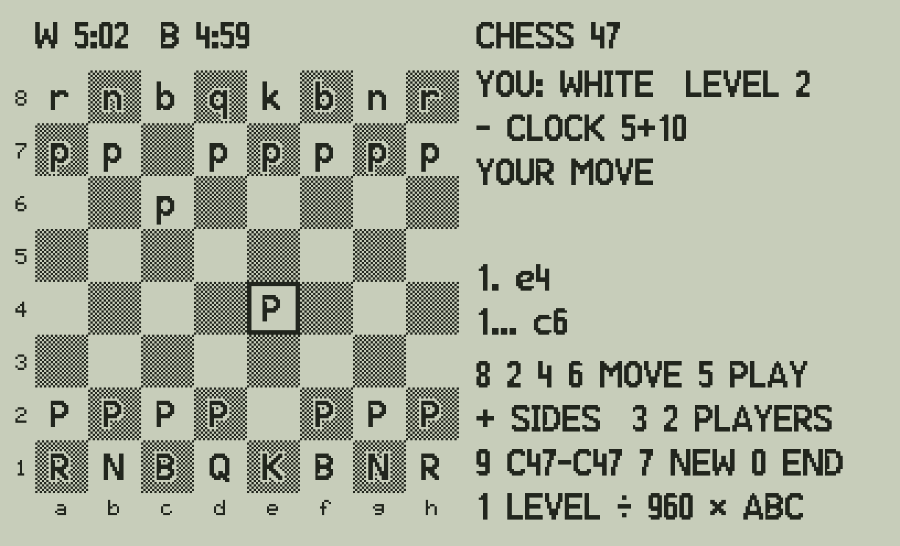

*× then e2-e4: the board in letters, the C47's reply played.*

This mode is ready for the chess font proposed for the C47 firmware: when the firmware has the chess pieces as
characters, the same mode can show them instead of the letters, and the drawings stored in the program can go.

## The end of the game

CHECKMATE and STALEMATE; DRAW: REPETITION (the same position the third time, the same side to move) and DRAW:
MATERIAL (kings only, or one bishop or knight). There is no 50-move rule.

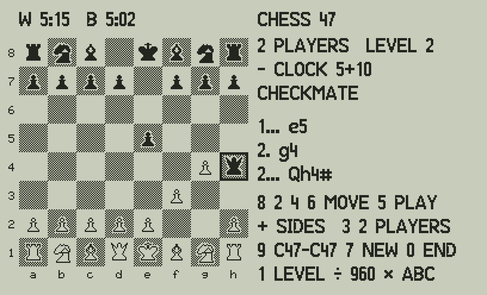

*Two players (3): 1. f3 e5 2. g4 Qh4#.*

## The clock

Both clocks run, the C47's too: the time it thinks is its own time, as for a person across the board. Each side
gets the time control's minutes and some seconds more for every move it plays (a Fischer clock). Choose the time
control with **−** before the first move; each press gives the next one, shown under your side (`- CLOCK 5+10`):

| | time | more a move | |
|---|---|---|---|
| **5+10** | 5 min | 10 s | the default |
| **3+2** | 3 min | 2 s | blitz |
| **5+3** | 5 min | 3 s | blitz |
| **10+5** | 10 min | 5 s | rapid |
| **15+10** | 15 min | 10 s | rapid (FIDE's rapid control) |
| **90+30** | 90 min | 30 s | classical (FIDE's control for most opens) |
| **90/40+30** | 90 min for 40 moves, then 30 min more | 30 s | classical (FIDE's control for the big events) |
| **NO CLOCK** | | | no time limit: the clocks count each side's time up |

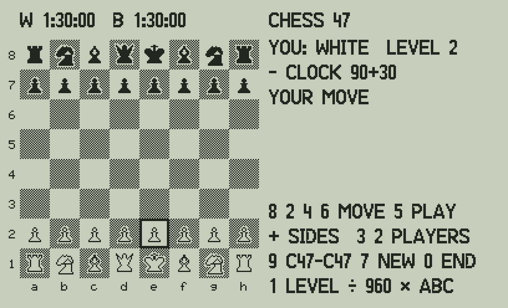

*− five times: 90+30, each side 1:30:00 (an hour or more is shown h:mm:ss).*

The control is kept for the next games and the next start. During the game **−** does not change it: it asks
**CLOCK OFF? - AGAIN**. Press **−** again and the clock is off for the rest of the game (for a long game, or
analysis): `- CLOCK OFF`, and the clocks count each side's time up from 0. Any other key says no and does nothing
else (0 does not end the game there). Only a new game (7, ÷) turns the clock on again.

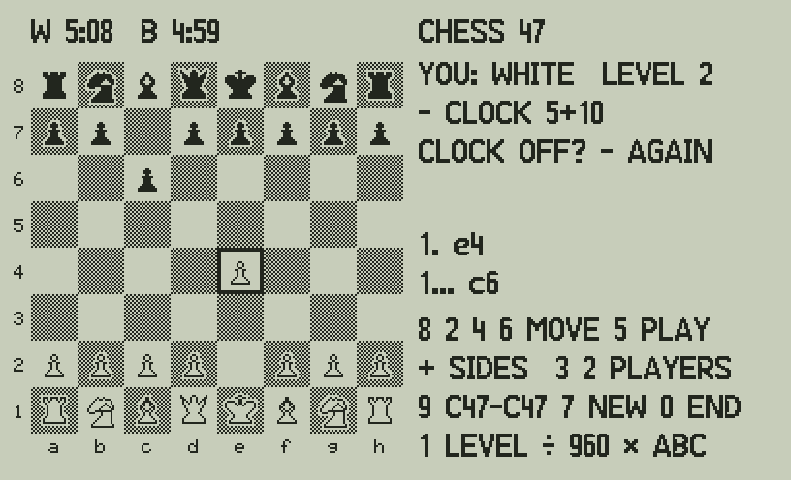

*− during the game: CLOCK OFF? - AGAIN.*

When the time of the side to move runs out, it loses (WHITE / BLACK LOST ON TIME), unless the other side could not
mate by any series of legal moves (a bare king, for example): then it is a draw (DRAW: TIME, NO MATE), as the FIDE
rules say. The C47 can lose on time too.

**How the C47 uses its time.** It gives each move a budget: its time left divided by the moves still to play
(30; with 90/40+30, the moves left to move 40, plus 2), plus the seconds it gets a move, and never more than a
quarter of its time left. Level 2 cannot stop halfway (it needs about 10-20 s a move), so when the budget is below
15 s the C47 plays that move at level 1 (a few seconds; the status line says THINKING ... (LEVEL 1)), and it goes
back to level 2 when it has time again. Levels 3, 4 and 5 search their third move within the budget (and never
longer than their 1, 3 or 9 minutes): at 90+30 level 5 gets about 3 minutes a move early in the game. With the
blitz controls (3+2, 5+3) it plays mostly at level 1. With NO CLOCK every level thinks as long as it always did.

**While the C47 thinks** the status line shows how far it is, THINKING (the level) and the move it is looking at,
of how many (`THINKING (2) 8/20`), and its clock runs down on the screen. At levels 3, 4 and 5 **any key makes it
move now**: it plays the best move it has found so far. Level 2 cannot be stopped (10-20 seconds).

Keys pressed while the C47 thinks are not taken as your moves when your turn comes: nothing moves by itself. Two of
them ask first: **0** asks **END? 0 AGAIN** (0 again ends and keeps the game, any other key says no), and **−** asks
CLOCK OFF?.

## Chess960

Chess960 (Fischer random chess): the pieces of the back rank start in one of 960 positions, the bishops on squares
of both colours and the king between the rooks; everything else is chess. Press **÷** and type the position's number
with three digits (066 for 66), or **÷** again for a random one; any other key goes back. 518 is the normal start.

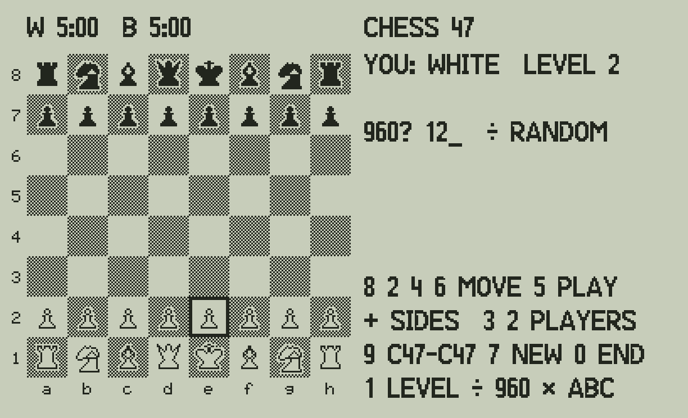

The number is shown under your side. The opening book is not used. **To castle, pick the king and then its own
rook**: the king goes to g (with the rook on its right) or c (on its left), the rook to f or d, as in normal chess.
The squares between them must be empty and the king may not be in check, pass through check or land in check.

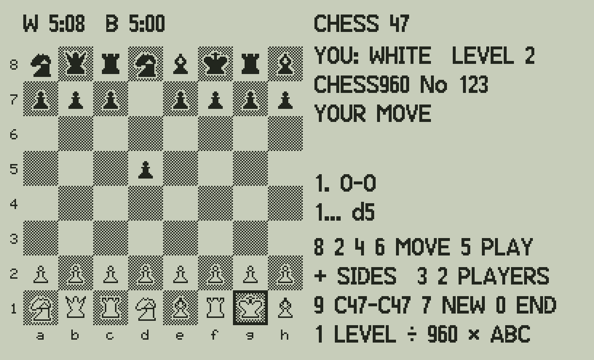

*Chess960 No 123 (NQRNBKRB): 2 6 5 6 5, the king f1 onto its rook g1: O-O, the king on g1, the rook on f1.*

0 keeps a Chess960 game with its number; **÷** or **7** goes back to normal chess (a new game).

Starfleet cadets may try the number 1701.

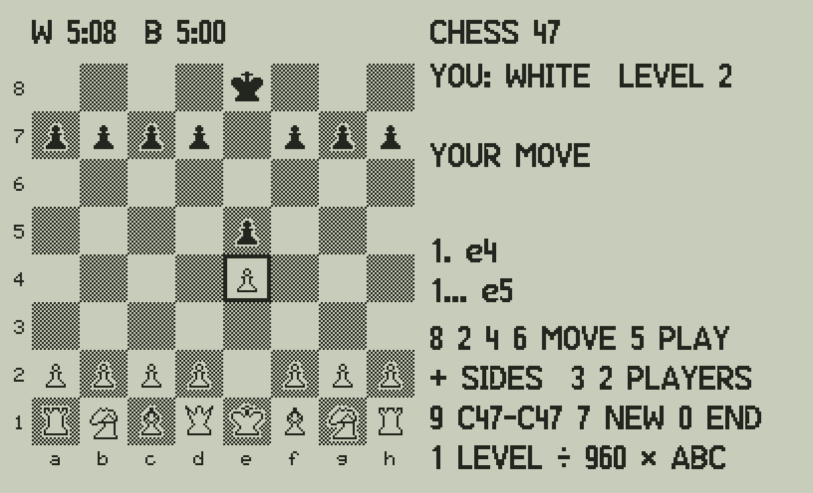

## What it changes on your calculator

Your stack and LASTx come back at the end. R00-R19 are not touched; R20-R99 are used and cleared at the end. WSIZE is
64 and your integer mode is given back. The game is kept in the variables CHN, GH, TW, TB and TOF (delete them to forget it);
the matrices it uses while running are deleted at the end. The variable CHF (1) stays only while you have
chosen the letters, TC (the time control) only while it is not 5+10. One program, CHESS47, with one global label.

On the computer, `tools/play47.py` is the same game with the same screen and keys (`pip install pygame`).
